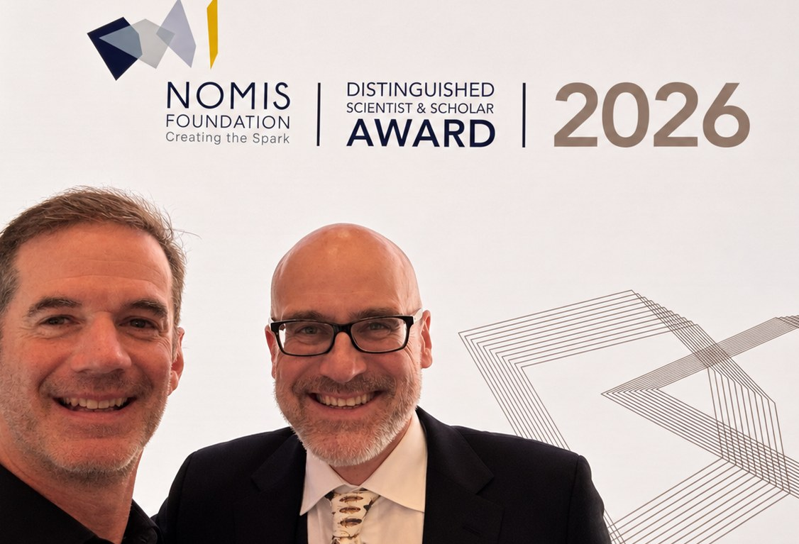

<!-- DRAFT — not for publication yet. `draft: true` keeps this post out of
     rendered output, listings and site search. Before publishing:
     1. check the text, especially the personal impressions;
     2. check Andy is happy to appear in the photo;
     3. remove `draft: true`. -->

What a night. On Thursday 15 October, the [NOMIS Foundation](https://nomisfoundation.ch) held its 2026 Award Ceremony at the Kunsthaus Zürich, and it was a real pleasure to be there.

{fig-alt="Owen Petchey (left) and Andrew Gonzalez (right) smiling in front of the NOMIS Foundation Distinguished Scientist & Scholar Award 2026 backdrop." fig-align="center"}

## The award

The [NOMIS Distinguished Scientist and Scholar Award](https://nomisfoundation.ch/research/awards/), established in 2016, honours researchers whose bold questions and broad approaches change how we understand the world, and who build bridges between the sciences and the humanities. Rather than rewarding past work alone, it backs people: each award funds a new, curiosity-driven research project. That fits the foundation's own philosophy. NOMIS, based here in Zurich and founded by Georg Heinrich (Heini) Thyssen, describes itself as being about enabling outstanding talent to take on high-risk research.

## This year's awardees

Three very different researchers, three very different questions:

- **[Andrew Gonzalez](https://nomisfoundation.ch/people/andrew-gonzalez/)**, Professor and Liber Ero Chair in Biodiversity Conservation at McGill University, Montreal — *A Mesoscale Theory of the Biosphere*. Andrew's project (2026–2031) aims to build a general theory of how ecological change at regional scales, between the local and the planetary, adds up to shape the stability of the biosphere: how connected ecosystems across landscapes, seascapes and regions buffer or amplify environmental change.
- **[Tobias Kippenberg](https://nomisfoundation.ch/people/tobias-kippenberg/)**, Full Professor of Physics and Electrical Engineering at EPFL, Lausanne — *The Quest for Ultralow Dissipation: From Self-Organized Light to Collective Quantum Drums*. Tobias is known for showing that tiny optical microresonators can generate optical frequency combs from a single laser on a chip, and for pioneering cavity optomechanics. His project asks how energy loss shapes the emergence of order in complex optical systems, and how quantum behaviour can be pushed to ever larger objects.
- **Ulrike Malmendier**, Cora Jane Flood Professor of Finance and Professor of Economics at the University of California, Berkeley — *Stress and Economics: Exploring the Alleviating Role of Predictability and Controllability*, on how stress interacts with economic behaviour.

## A personal note

I was especially delighted to see Andrew honoured. We go back a long way: some of our first papers together, in the late 1990s, were about how the colour of environmental noise affects population persistence ([Petchey, Gonzalez & Wilson 1997](https://doi.org/10.1098/rspb.1997.0254)), including building a [novel experimental apparatus](https://doi.org/10.1098/rspb.1998.0257) to expose populations to white and 1/f noise. More recently we have worked together on [how prior exposure to stress lets an ecosystem cycle survive severe acidification](https://doi.org/10.1111/oik.07829) and on [expert perspectives on global biodiversity loss](https://doi.org/10.1002/fee.2536). A theory of how ecological change scales up across the biosphere is exactly the kind of big, bold question this award was made for, and it is great to see it backed.

Congratulations to Andrew, Tobias and Ulrike, and thank you to the NOMIS Foundation for a wonderful evening, and for championing curiosity-driven research.
